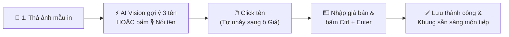

# Sổ Tay Hướng Dẫn Dành Cho Nhân Viên (Staff Guide)
## Quy Trình Đăng Sản Phẩm Siêu Tốc (10–15 Giây / Món) — Xưởng BaSa3D

Tài liệu này hướng dẫn chi tiết quy trình đăng sản phẩm mới dành cho nhân viên vận hành và thợ in tại xưởng BaSa3D qua trang quản trị:
👉 **Đường dẫn trang đăng:** `/basaadmin/products/new`

---

## 1. Tổng quan quy trình 3 bước siêu tốc



---

## 2. Hướng dẫn chi tiết từng bước

### Bước 1: Tải ảnh mẫu in 📸
* Kéo & thả 1 hoặc nhiều ảnh chụp mẫu in 3D vào khung **"1. Ảnh mẫu in"**.
* Ngay khi ảnh bìa được tải vào, hệ thống trí tuệ nhân tạo (chạy trực tiếp trên card đồ hoạ **NVIDIA RTX 4060** của xưởng) sẽ phân tích vật thể trong ảnh trong **~300 mili-giây** và hiển thị huy hiệu:
  * `⚡ AI Local (RTX 4060)` kèm **3 tên tiếng Việt gợi ý chuẩn SEO** (VD: *Móc khoá mèo Shiba in 3D*, *Mô hình mèo để bàn*).

### Bước 2: Chọn tên sản phẩm & Danh mục 🏷️
Bạn có 3 cách cực kỳ nhanh:
* **Cách 1 (Nhanh nhất):** Bấm trực tiếp vào **1 trong 3 chip tên gợi ý** bên dưới ô tên.
  * Hệ thống tự điền tên sản phẩm.
  * Tự động nhận diện danh mục phù hợp (hiển thị thẻ danh mục kèm emoji như `🔑 Móc khoá`, `🧸 Mô hình`, `🏠 Trang trí`).
  * **Con trỏ chuột tự động nhảy thẳng vào ô "Giá bán"** mà không cần rê chuột.
* **Cách 2 (Bằng giọng nói 🎙️):** Bấm nút **`🎙️ Nói tên`** cạnh ô Tên sản phẩm → Nói tiếng Việt rõ ràng (VD: *"Móc khoá rồng vàng"*). Hệ thống sẽ tự nghe, gõ chữ và chọn danh mục.
* **Cách 3 (Bấm nút tiền tố):** Bấm các nút tiền tố nhanh như `+ Móc khoá`, `+ Mô hình`, `+ Decor để bàn`.

### Bước 3: Điền giá & Bấm phím tắt lưu siêu tốc ⌨️
* Gõ giá bán niêm yết (ví dụ: `45000` hoặc `89000`).
* Nhấn tổ hợp phím trên bàn phím:
  * **Windows:** Bấm **`Ctrl + Enter`**
  * **Mac:** Bấm **`Cmd + Enter`**
  * *(Hoặc click nút màu xanh "Lưu & Thêm tiếp" ở cuối form).*
* **Kết quả:**
  * Sản phẩm được lưu thành công vào cơ sở dữ liệu.
  * Xuất hiện thông báo xác nhận: *"Đã lưu thành công [Tên món]"*.
  * Toàn bộ form được làm mới sạch sẽ và đưa con trỏ về khung tải ảnh để nhân viên thả tiếp món thứ 2!

---

## 3. Quản lý nơi lưu file 3D cho thợ in (Tuỳ chọn) 📁

Để khi khách đặt hàng trên web, thợ in chỉ việc mở file in ngay mà không mất công tìm kiếm:
Tại khối **"Lưu trữ file 3D & Nguồn model (Tuỳ chọn)"**, nhân viên có thể điền:
1. **Link nguồn mẫu (Web):** Dán link gốc nếu tải từ MakerWorld, Printables, Thingiverse để tiện kiểm tra bản quyền.
2. **Nơi lưu file trên máy xưởng (Local):** Dán đường dẫn thư mục/file trên máy tính xưởng (VD: `D:\3D_Models\MocKhoa\MeoShiba.3mf`). Thợ chỉ cần copy đường dẫn này mở trong **Bambu Studio / OrcaSlicer** in ngay.
3. **Link Google Drive:** Dán link Drive backup file 3D của xưởng.

---

## 4. Hướng dẫn mở kết nối AI từ xa (Cloudflare Tunnel) 🌐

Nếu sau này website chính thức chạy trên máy chủ đám mây (Netlify/Vercel) mà xưởng vẫn muốn **tận dụng card RTX 4060 của máy tính xưởng** (0 đồng tiền token):
1. Trên máy tính xưởng, vào thư mục dự án và double-click file:
   👉 **`Mo_Cong_Ollama_Cloudflare.bat`**
2. Cửa sổ dòng lệnh sẽ chạy và tạo một đường link HTTPS an toàn:
   ```text
   https://xxxx-xxxx-xxxx.trycloudflare.com
   ```
3. Copy link này gửi cho quản trị viên cấu hình vào hệ thống là web bên ngoài sẽ kết nối thẳng vào card RTX 4060 ở xưởng!

---

## 5. Bảng phím tắt & Mẹo thao tác nhanh

| Thao tác | Phím tắt / Nút bấm | Tác dụng |
| :--- | :--- | :--- |
| **Lưu & Thêm món tiếp** | `Ctrl + Enter` (hoặc `Cmd + Enter`) | Lưu sản phẩm và reset form ngay lập tức |
| **Nói tên sản phẩm** | Click nút `🎙️ Nói tên` | Nhập liệu giọng nói tiếng Việt tự động |
| **Tạo danh mục mới** | Click nút `+ Thêm mục` inline | Tạo nhanh danh mục mới không cần rời trang |
| **Nhận diện lại ảnh** | Click `✨ Nhận diện lại từ ảnh` | Quét lại ảnh nếu đổi ảnh bìa khác |
