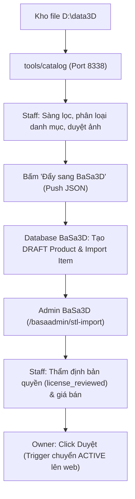

# BaSa3D Catalog Pipeline & Review Workflow

## 1. Tổng quan kiến trúc

Pipeline quản lý và số hóa kho mô hình 3D cho BaSa3D bao gồm 2 thành phần chính:
1. **Catalog Desktop Tool (`tools/catalog/`)**:
   - Chạy Python HTTP server local (mặc định cổng 8338, bind `127.0.0.1`).
   - Quét kho mô hình 3D vật lý (mặc định tại `D:\data3D`).
   - Tự động bóc tách thumbnail từ `.3mf` và `.zip`, tính toán bounding box, thể tích, số tam giác.
   - Quản lý chỉ mục chống trùng lặp (`fingerprint_index.sqlite`).
   - Cung cấp giao diện web local `catalog.html` để:
     - Phân loại danh mục (Category).
     - Di chuyển thư mục trực tiếp trên ổ đĩa.
     - Đánh giá sơ bộ trạng thái: `PENDING`, `APPROVED`, `DEFERRED`.
     - Xuất bundle JSON và đẩy dữ liệu sang BaSa3D qua API `/api/push_basa3d/start`.

2. **BaSa3D Importer & Admin Review (`src/services/catalog-json-import.service.ts` & `/basaadmin`)**:
   - `scripts/stl-import/import-from-json.ts`: Đọc JSON bundle, tải ảnh WebP lên Supabase Storage (`product-images`), tạo bản ghi `products` (trạng thái `DRAFT`, kiểu `MADE_TO_ORDER`), tạo `product_variants` và `product_import_items`.
   - `scripts/stl-import/dev-bridge-sync.ts`: Đồng bộ giá nhựa hiện hành và bảng quy đổi giá từ BaSa3D sang Catalog tool.
   - Giao diện Admin tại `/basaadmin/stl-import` và `/basaadmin/products`.

---

## 2. Cách khởi động nhanh

Từ thư mục gốc dự án `e:\AOO\BaSa3D`:

* **Cách 1 (Launcher tổng hợp)**:
  Double-click hoặc chạy:
  ```bat
  .\start-dev.bat
  ```
  File này sẽ tự động dọn dẹp port 3000/8338 cũ và mở đồng thời 2 tab Windows Terminal:
  - Tab 1: `npm run dev` (BaSa3D Next.js dev server tại `http://localhost:3000`)
  - Tab 2: `npm run catalog` (Catalog server tại `http://127.0.0.1:8338`)

* **Cách 2 (Khởi động riêng Catalog)**:
  ```bash
  npm run catalog
  ```
  Trình duyệt sẽ tự động mở trang `http://127.0.0.1:8338/catalog.html`.

---

## 3. Cấu hình biến môi trường (`.env.local`)

| Biến | Mặc định | Mô tả |
| :--- | :--- | :--- |
| `CATALOG_DATA_DIR` | `D:\data3D` | Đường dẫn thư mục chứa các thư mục mô hình 3D nguồn |
| `CATALOG_OUT_DIR` | `<repo>/.catalog-data` | Nơi lưu trữ cache runtime (thumbs, json, sqlite index) |
| `CATALOG_PORT` | `8338` | Cổng HTTP của catalog server |
| `NO_OPEN_BROWSER` | `0` | Đặt `1` nếu không muốn tự động bật trình duyệt khi start server |

> [!NOTE]
> Toàn bộ dữ liệu nặng (`thumbs/`, file nhị phân SQLite, JSON xuất khẩu) đã được cấu hình trong `.gitignore` để không làm phình dung lượng git repo.

---

## 4. Quy trình làm việc (Staff Review & Owner Publish)



1. **Tầng 1 (Tại Catalog Tool - Staff & Owner)**:
   - Staff xem thư viện mẫu trên `catalog.html`.
   - Kéo thả, chuyển danh mục chuẩn (`Clicker`, `Keychain`, `Pokemon`, `Anime`,...).
   - Loại bỏ mẫu rác / trùng lặp (tính năng dedup index).
   - Tick chọn các mẫu đạt chuẩn và chọn **Duyệt (APPROVED)**.
   - Nhấn **Đẩy sang BaSa3D** để importer tự động tạo bản nháp DRAFT trên web.

2. **Tầng 2 (Tại BaSa3D Admin `/basaadmin` - Staff Thẩm định & Owner Duyệt)**:
   - Nhân viên (`STAFF`) vào `/basaadmin/stl-import`:
     - Kiểm tra chi tiết thông số kích thước (bbox), số lượng biến thể, ảnh đại diện.
     - Xác nhận bản quyền (`license_type` và `license_reviewed = true`).
     - Gắn mức giá niêm yết phù hợp.
   - Chủ shop (`OWNER`):
     - Lọc danh sách mẫu đã sẵn sàng.
     - Thực hiện bấm **Duyệt hàng loạt (Bulk Approve)** để kích hoạt sản phẩm sang `ACTIVE`.
     - Tuân thủ quy tắc bảo mật database trigger: Chỉ `OWNER` mới có thể publish sản phẩm lên storefront.
