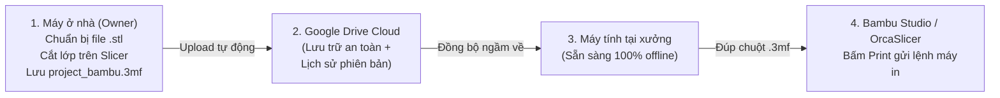

# Hướng dẫn Lưu trữ File 3D & Đồng bộ Xưởng In (Storage & Sync SOP)

Tài liệu hướng dẫn cấu hình lưu trữ file thiết kế in 3D (STL, 3MF, STEP) và quy trình đồng bộ giữa máy tính cá nhân (thiết kế/chuẩn bị file) và máy tính điều khiển xưởng in.

---

## 1. Cấu trúc thư mục chuẩn (`BaSa3D-Storage`)

Thư mục file in 3D được phân cấp theo **Danh mục cấp 1** (`CATEGORY_CODE`) và **Mã sản phẩm/SKU**:

```text
📁 BaSa3D-Storage/
├── 📁 FIG/ (Figure & Model)
│   └── 📁 FIG-DRAGON-WARRIOR/
│       ├── model_v1.stl          # File 3D thô
│       ├── project_bambu.3mf     # File project đã cắt lớp (slice), set sẵn support/layer/AMS
│       └── license_proof.png     # Ảnh chụp bằng chứng license/bản quyền thương mại
├── 📁 DEC/ (Home Decor)
│   └── 📁 DEC-DESK-ORGANIZER/
│       └── organizer.3mf
├── 📁 ACC/ (Accessories & Gadgets)
├── 📁 GIFT/ (Gifts & Personalized)
└── 📁 PART/ (Prototype & Functional Parts)
```

### Quy tắc đặt tên file:
* **Tên không dấu**, sử dụng chữ hoa/thường nối nhau bằng dấu gạch ngang `-` hoặc gạch dưới `_`.
* Không dùng ký tự lạ (`#`, `%`, `&`, `[`, `]`, `(`...) để tránh lỗi đường dẫn khi phần mềm slicer và máy in (Bambu OS / Klipper) nạp file.

---

## 2. Cấu hình Google Drive for Desktop trên máy tính

### 2.1. Thiết lập chung
* Chế độ đồng bộ tài khoản: **Stream files (Phát trực tuyến tệp)** để không đầy ổ cứng.
* Cố định ký tự ổ đĩa (trên Windows): Gán cố định là ổ **`G:\`** (trong Google Drive Preferences > Settings).

### 2.2. Bật chế độ Offline cho thư mục in (BẮT BUỘC TRÊN MÁY XƯỞNG)
Để đảm bảo khi mất mạng internet hoặc mạng chập chờn, máy in vẫn mở được file `.3mf` ngay lập tức:
1. Mở ổ đĩa Google Drive trên máy tính xưởng.
2. Chuột phải vào thư mục `BaSa3D-Storage`.
3. Chọn **Offline access (Truy cập ngoại tuyến)** → Chọn **"Available offline" (Khả dụng khi ngoại tuyến)**.
4. Chờ Google Drive tải toàn bộ file về lưu trữ cục bộ.

---

## 3. Luồng vận hành (Workflow)



1. **Chuẩn bị file (Máy ở nhà):**
   - Mở file `.stl` trong Bambu Studio / OrcaSlicer, cấu hình thông số chuẩn (chiều cao lớp, hướng đặt, support, màu nhựa).
   - Bấm **File > Save Project As...** lưu file `.3mf` trực tiếp vào `BaSa3D-Storage/<CATEGORY>/<SKU>/`.
2. **Thực thi in khi có đơn (Máy tại xưởng):**
   - Đơn hàng web báo mã SKU (ví dụ: `FIG-DRAGON-WARRIOR`).
   - Thợ mở đúng thư mục mã SKU, đúp chuột vào file `.3mf`.
   - Kiểm tra cuộn nhựa trên máy in và bấm **Print** qua WiFi/LAN nội bộ.

---

## 4. Tiện ích và An toàn dữ liệu

* **Khôi phục thông số in cũ (Version History):** Khi chỉnh sửa file `.3mf` bị lỗi in, chuột phải vào file trên Google Drive Web > *Manage versions* để tải lại phiên bản ngày trước đó.
* **Chống xoá nhầm:** Nếu dùng tài khoản riêng cho máy xưởng in, chia sẻ thư mục `BaSa3D-Storage` với quyền **Viewer (Người xem)** để thợ chỉ mở file in mà không thể bấm xoá nhầm thư mục gốc.
